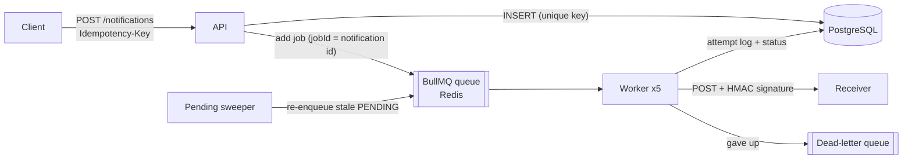

# nest-notification-hub

Notification delivery service built with **NestJS**, **BullMQ** (Redis) and **PostgreSQL**.

Clients send a notification request once; the service stores it, queues it, and delivers it
asynchronously through a channel (webhook, email, WhatsApp sandbox), retrying with exponential
backoff and parking messages that keep failing in a dead-letter queue.

## Why this project

Delivering messages to third parties is a classic source of production incidents: slow providers,
timeouts, duplicated sends after a retry. This repo is a small, readable reference for the patterns
that handle that:

- idempotent API (`Idempotency-Key`) so a client retry never creates a duplicate
- queue + workers to decouple the HTTP request from the slow delivery
- retries with exponential backoff, and a dead-letter queue for poison messages
- delivery attempts persisted for auditing
- health checks and metrics

## API

### `POST /notifications`

Requires an `Idempotency-Key` header (8-128 chars). The recipient format depends on the channel:
`WEBHOOK` takes an http(s) URL, `EMAIL` an e-mail address, `WHATSAPP` an E.164 phone number.

```bash
curl -i localhost:3000/notifications   -H 'Content-Type: application/json'   -H 'Idempotency-Key: order-42-paid'   -d '{"channel":"WEBHOOK","recipient":"https://example.com/hooks","payload":{"orderId":42}}'
```

| Situation | Response |
| --- | --- |
| New key | `202 Accepted` + the notification (`status: PENDING`) |
| Same key, same body (client retry) | `200 OK` + the same notification, nothing duplicated |
| Same key, different body | `409 Conflict` |
| Missing/invalid header, wrong recipient format, unknown fields | `400 Bad Request` |

The body is hashed with keys sorted at every level, so `{"a":1,"b":2}` and `{"b":2,"a":1}` count as
the same request. Concurrent requests with the same key are settled by a unique index: one insert
wins and the others return the winner (covered by an e2e test that fires 5 requests at once).

### `GET /notifications/:id` and `GET /notifications/:id/attempts`

Current state of a notification and its delivery attempt log.

## How delivery works



| Situation | What happens |
| --- | --- |
| Receiver answers 2xx | `DELIVERED`, attempt logged |
| Timeout, network error, 408, 429, 5xx | `FAILED`, BullMQ retries with exponential backoff (default 5 attempts) |
| Last attempt fails | `DEAD_LETTERED`, job copied to the dead-letter queue |
| 4xx such as 400/404/410 | `DEAD_LETTERED` right away: retrying will not fix a bad request |
| Duplicated or late job for a delivered notification | Skipped: the worker checks the status first (idempotent consumer) |
| Process dies between INSERT and enqueue | Row stays `PENDING`; the sweeper re-enqueues it after 60s |

Dead letters are listed with `GET /notifications?status=DEAD_LETTERED` and can be sent again
with `POST /notifications/:id/retry` once the receiver is fixed.

Every webhook carries `X-Notification-Id` (to deduplicate on the receiver side, since delivery is
at-least-once) and `X-Signature: sha256=<hmac of the body>` so the receiver can verify the sender.

Email and WhatsApp use **sandbox providers** that only log. They implement the same
`ChannelProvider` interface a real provider (SES, WhatsApp Cloud API...) would.

### Trade-offs

- **At-least-once, not exactly-once.** If the worker crashes after the receiver got the request
  but before the status is saved, the message is sent again. That is why the notification id is
  in a header: receivers should deduplicate on it.
- **Sweeper instead of a transactional outbox.** The outbox pattern would remove the gap between
  the INSERT and the enqueue entirely; the sweeper is simpler and good enough for this scope.

## Observability

| Endpoint | What |
| --- | --- |
| `GET /health` | Readiness: checks PostgreSQL and Redis, `503` if either is down |
| `GET /metrics` | Prometheus: `notification_deliveries_total{channel,result}`, `notification_delivery_duration_seconds`, Node.js defaults |
| `GET /docs` | OpenAPI (Swagger UI) |

Useful alerts from these metrics: rate of `result="dead_lettered"` above zero, and p95 delivery
duration approaching the timeout (receivers getting slow before they fail).

## Operations console

[react-notification-console](https://github.com/natanws/react-notification-console) is a React UI
for this API (list by status, attempt timeline, retry dead letters). Allowed origins are set with
`CORS_ORIGINS` (default `http://localhost:5173`).

## Run with Docker

```bash
docker compose --profile app up --build   # PostgreSQL + Redis + the service on :3000
```

## Development workflow

- `main` is protected: changes land through pull requests.
- CI runs on every PR: lint, formatting, typecheck, unit tests with coverage, build,
  [Conventional Commits](https://www.conventionalcommits.org/) on every commit and on the PR title.
- Husky runs commitlint and the fast checks locally before each commit.

## Getting started

```bash
cp .env.example .env
docker compose up -d        # PostgreSQL + Redis
npm ci
npx prisma migrate deploy
npm run start:dev           # http://localhost:3000/health
npm test                    # unit tests
npm run test:e2e            # API + queue + worker against real PostgreSQL/Redis
```

## License

MIT
